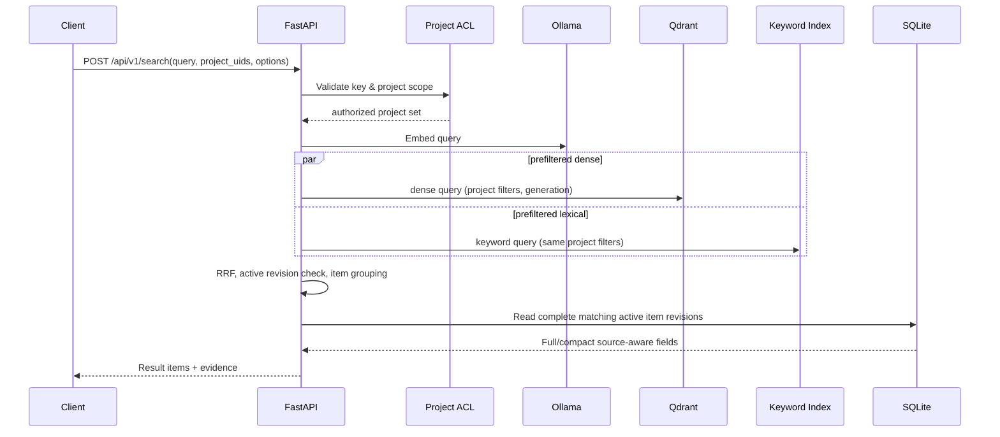
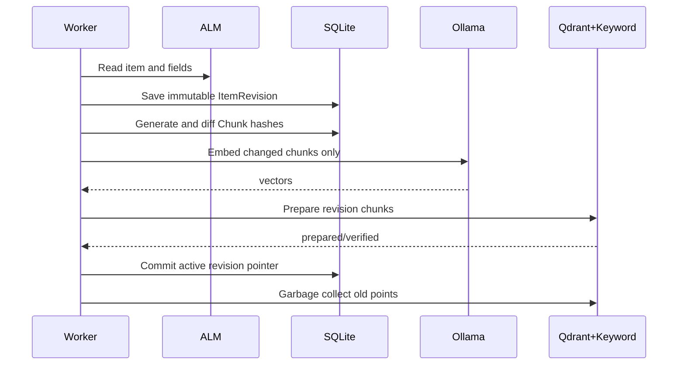

# Interfaces & Sequence Contracts

## Connectors
Interface `AlmConnector` (Python Protocol, future): `probe()`, `list_projects()`, `list_containers(project)`, `iter_item_refs(scope, checkpoint)`, `get_item(ref)`, `get_field_definitions(scope)`, `list_item_relations(ref)`, `list_attachments(ref)`, `download_attachment(ref)`, `render_content_to_html_if_supported(ref, field)`.

All methods return source-aware raw envelopes, pagination metadata and permission/unsupported-feature diagnostics. Auth tokens are injected via SecretProvider and never serialized into raw item JSON.

## Retrieval request flow

## Item sync

## API design decisions
- `project_uids` is mandatory for search and subset of principal scope.
- `top_k` specifies distinct items, not vector points.
- Relation IDs are returned only on explicit include_relations and permitted scope.
- Optional fields change response size, never backend authorization.
- POST `/v1/projects/{id}/sync` creates a durable Job and returns 202+job_id; does not block for full execution.
- Errors are structured, with machine code, job_id/trace_id where available; suppress secrets/raw source content.
- Exact endpoint definitions in `docs/api/openapi.yaml` are **draft design**, not confirmed ALM or implemented application endpoints.

## v0.2 공통 서비스 계약 확장
- `AlmConnector.list_collectable_scopes(project) -> CodebeamerTracker[] | PolarionWorkItemType[]` and `get_capabilities()`; user-facing `scope_kind` discriminates variants.
- `ALMHttpClient.request(endpoint, server_budget, credential_scope, idempotency)` handles per-server token bucket, Retry-After, 429/5xx backoff and error classification. Connector implementation must not bypass rate-limited transport for attachments/wiki rendering.
- `Chunker.make_chunks(normalized_field, max_input_tokens, config) -> Chunk[] | ProcessingError`, with complete source-span coverage and token-count assertion. No silent truncate.
- `FailureRepository.add_attempt()`, `list_failed_items(job_uid)`, `replay_item(job_uid, item_uid, from_stage, force_recollect)` with stage dependency check and stable idempotency key.
- `JobService`: PARTIAL / COMPLETED_WITH_ERRORS, PAUSED, BLOCKED are distinct; UI/API reflects Item local errors and server-global causes.
- `POST /v1/alm-instances`, `POST /v1/alm-instances/{id}/probe`, `GET /v1/alm-instances/{id}/projects`, `GET /v1/alm-instances/{id}/projects/{projectId}/scopes`, `POST /v1/projects/{uid}/preflight` (API server prefix `/api/v1`). Detailed Draft in `docs/api/openapi.yaml`.

## v0.3 단계별 계약 · API naming
- Public base path는 **`/api/v1`**이다. 본문에 `/v1/...`로 표기된 것은 OpenAPI 상 `/api/v1/...`로 해석한다.
- API 계약 설계 원본은 `docs/api/openapi.yaml`이고, `docs/api/API_COVERAGE.md`에 Endpoint coverage와 미정 스키마를 기록한다.
- 제품별 URL/Tracker·Type API의 정확한 Request/Response는 대상 서버 버전별 M2 Contract Fixture로 확인하고, 추정된 URI를 런타임 구현 사실로 주장하지 않는다.
- `stage_job`은 `SYNC|COLLECT|PROCESS|EMBED|INDEX|REBUILD_INDEX` 요청과 의존성 유효성 검사를 포함한다. 상태 조회·재처리는 Project Scope 검사를 수행한다.
- Stage별 의존성: `COLLECT -> PROCESS -> EMBED -> INDEX`; 저장된 내용과 config fingerprint가 유효할 때만 중간 Stage 독립 실행이 가능하다.
- `POST /api/v1/projects/{project_uid}/sync`는 `stage=SYNC`의 alias이며 Job 202를 즉시 반환한다.
- rate-limited Transport는 탐색/페이지/Item/Wiki render/첨부 모두 공유하며 `Retry-After`를 서버 단위로 전파한다.
- 내보내기/백업 및 Notion 동기화에는 승인·비밀/원문 필터가 적용된다. 실제 GitHub/Notion 자동 액션은 미구현이다.
