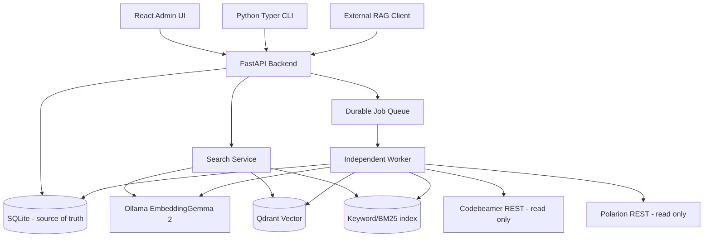

# Software Architecture Description (SAD) — Review Candidate v0.3

## 1. Architecture drivers
- 여러 ALM 서버/프로젝트의 Item을 중복·누락 없이 동일 스키마에 보관
- Text/Table 의미 보존, Item-aware 검색, 선택적 재임베딩
- Item 단위 공개 원자성 및 장애 복구, Qdrant+SQLite 간 정합성
- 10만 Item / API P95 3초 목표 / 로컬·원격 Ollama·Qdrant
- 프로젝트별 격리 및 관리자/API Key 권한

## 2. Context & component

## 3. Module responsibilities
| Module | Responsibility | Contract |
|---|---|---|
| connectors/codebeamer | Tracker/Item/Fields/Relations/Attachments; wiki2html context | normalized raw envelope |
| connectors/polarion | Work Item Type/Item/fields/links/attachments | normalized raw envelope |
| normalization | field type mapping, HTML DOM, Table JSON, links preserved | ordered structured blocks |
| chunking | field-aware text/table chunks, hashes, offsets | immutable chunk version |
| embedding | Ollama /api/embed, model fingerprint, batch/backoff | embedding vectors and metadata |
| indexing | dense/sparse or FTS, staging, project generation | searchable index |
| retrieval | auth → project scope → dense+keyword → RRF → group → SQLite item | SearchResponse |
| orchestration | FIFO project lock, checkpoint, retry | Job / Step records |
| admin | credentials, projects, explorer, evaluation, audit, backup | REST+UI |

## 4. Data truth and versioning
SQLite owns ALM Instance, Project, Container, Item identity, Item Revision, Field definitions/values, relation, attachment, structured blocks, chunks, job checkpoints, selected active item revision, active index generation and configuration. Qdrant stores replaceable vectors+payload. Every retrieval hit carries item_uid, project_uid, chunk_id, revision_uid, index_generation.

`item_uid = canonical identity (instance UID + project source ID + source Item ID)`; do not derive stable identities from mutable names or URLs alone. Item Revision UID is separate; original source revision labels preserved.

## 5. Item-level safe publication — architectural decision
1. Persist immutable new Item Revision to SQLite, leaving `active_revision_uid` unchanged.
2. Transform and validate all required blocks; calculate chunk fingerprints (text+model+tokenization/prefix+chunker config).
3. Generate only changed embeddings, stage associated index points/keyword entries with revision_uid and publication state.
4. Confirm dense/keyword prepared and required data integrity.
5. Atomically change `active_revision_uid` in SQLite transaction. Search service **must validate** candidate revision_uid against currently active revision before Item restoration; avoid mixing stale/new fields.
6. Retire old index points asynchronously; rollback pointer only while historical staged points remain and before global generation cleanup.

**Caveat:** SQLite and Qdrant have no shared ACID transaction. Retrieval post-validation is required, and overfetch/backfill is needed to preserve top_k and recall while staged points coexist. Qdrant payload-only updates alone cannot guarantee atomic publication across multiple points. This strategy is a design candidate requiring integration stress tests, not a proven implementation.

## 6. Project-wide full index rebuild
Build new generation separately (dedicated collection or generation-specific partitioning), validate completeness, compare query benchmark, and change active generation pointer. Keep old generation until all in-flight searches finish; delete immediately afterwards (Q25). Permanent rollback after cleanup is unavailable, though fresh rebuild from SQLite remains possible.

## 7. Project search constraints
Require explicit project_uids; API Key scopes checked server-side. Apply project constraints **inside both retrieval channels**, not just at response rendering. Enforce scope again when restoring Item and relationships. Different ALM instances and duplicate human names are distinct.

## 8. Workers, recovery, and external services
Single project pipeline globally active at once, FIFO persisted Job list. ALM rate controls/attachments/parser/Ollama concurrency distinct. Stage dependencies and checkpoints; retry idempotently using content_hash/revision UID and stable point UUID. API and Worker are separate processes sharing domain modules. SQLite WAL needs concurrent-read considerations; only one DB writer where practical.

## 9. Security and deployment
- Restrict ALM connectors to GET/read-only operations; exception `wiki2html` is POST rendering but should not mutate ALM Item. Confirm server audit behavior.
- Secrets encrypted with separately stored master key/OS keychain. Avoid embedding credentials in Git, logs, Notion, backups without explicit escrow policy.
- Host or remote Ollama/Qdrant TLS/auth configurable; remote endpoints may need private network/VPN.
- Docker Compose + Native app launch; do not assume Qdrant supports a native binary on each OS identically. Document OS-specific methods.
- HTML display requires sanitization and safe rendering (XSS protection); attachments and exports use allowlisted storage paths.

## 10. Architecture verification
Requirement-to-component-to-API-to-tests matrix, data recovery tests, project leakage tests, mismatch/staging tests, performance benchmark, immutable revision tests. See `docs/testing/TEST_PLAN.md`.

## 11. v0.2 상세 설계 확장 (추가 검토 여섯 항목)
- 등록 UI는 `source_type` discriminated Server Profile과 ALM별 `scope_kind`를 사용한다. CB Tracker ID != Polarion Work Item Type ID; 둘의 공통 추상화를 억지로 동일 DB 테이블에 강제하지 않는다. `docs/design/ALM_ONBOARDING.md` 참조.
- Chunk 길이는 모델 입력 예산의 하위 제약이며 모든 Item 텍스트/필드는 SQLite에서 유지한다. 각 `Chunk.input_tokens`와 `source_span`을 추적하고 truncate 미탐지 0을 인수기준으로 둔다. `docs/design/CHUNKING_POLICY.md` 참조.
- API/Worker는 하나의 Python Image로 분리 실행, Frontend는 Node Builder+정적 Runtime Image. SQLite는 공유 로컬 볼륨, Qdrant/Ollama는 내부/원격 접속 설정. `docs/architecture/DEPLOYMENT_AND_DEPENDENCIES.md` 참조.
- 서버 단위 Token Bucket/Concurrency Semaphore/Minimum Interval과 429 Retry-After Pause/Circuit Breaker를 공통 HTTP Transport에 둔다. 인증 실패는 전역 PAUSE/권한 실패는 분류/격리. `docs/design/API_THROTTLING_AND_RETRY.md` 참조.
- Stage별 멱등성 및 Item-local Failure Queue, 독립 Item Replay API/CLI와 Job terminal state `COMPLETED_WITH_ERRORS` 추가. 알 수 없는 404는 삭제라고 즉시 판단하지 않는다. `docs/design/FAIL_SAFE_AND_REPLAY.md` 참조.
- 모든 개발 Milestone에서 Test-first Red/Green/Refactor, Contract Mock, Crash Recovery E2E를 CI 증거와 연결. `docs/design/TDD_POLICY.md` 참조.

**설계 리스크:** Singleton local SQLite+복수 독립 API/Worker에서 lock 장시간 점유를 피하고 단일 Writer 정책, WAL, busy timeout, transaction 경계를 M1에서 실측해야 한다. API 외부 Job이 영속 Server Rate Limit을 초과하지 않도록 상태 동기화한다.

## 12. Baseline v0.3 — 검색 가시성 및 장애 원자성 계약
**Q22 B / Q24 B / Q25 A에 대한 상세화이며 신규 사용자 결정을 추가하지 않는다.**
- `ItemRevision`은 immutable, `Item.active_revision_uid`가 유일한 검색 가시성 기준이다. 새 Revision/Chunk를 SQLite `PREPARED` 상태로 저장하고 Dense+Keyword 인덱싱 완료 증거와 chunk-coverage 검증 후 SQLite 트랜잭션에서 active pointer를 교체한다.
- Qdrant/Sparse 인덱스는 SQLite와 분산 ACID가 없으므로, 검색 후보는 **두 검색 채널에서 사전 프로젝트/세대 필터** → SQLite `active_revision_uid` 검증 → 필요 시 제한된 overfetch/backfill → Item UID 단일 반환 순서를 따른다. 권한 검사는 후보 검색 전과 응답 조립 모두 수행한다.
- 같은 쿼리에서 Item Revision이 업데이트되는 경우 반환 본문/출처/Chunk 메타데이터는 **검증 시점 하나의 Revision**만 사용한다. SQLite read transaction/snapshot 아래에서 필터링하고, 활성 포인터가 변경되었다면 재검증·후보 보충; old/new 혼합 금지. 무한 반복을 막기 위한 최대 보충 횟수와 부족 결과 상태를 정의한다.
- 실패 Item의 신규판은 절대로 active pointer로 게시하지 않는다. 기존 정상 검색 판은 계속 제공한다. 원본 Metadata only 변경의 Qdrant payload 갱신도 원자성/장애 안전성을 검증한다.
- 세대 교체는 `generation_uid`별 모든 대상 Item 및 양 채널 커버리지를 검사하고 **원자적 프로젝트별 active generation 포인터** 교체 후, 선행 검색이 종료되면 이전 세대를 삭제한다. 이전 세대가 삭제된 뒤 즉시 롤백은 불가능하며 필요 시 SQLite 원본으로 새 세대 재구축한다.
- 여러 프로젝트 동시 검색 시 각 프로젝트의 active generation이 다를 수 있으므로 프로젝트-세대 Pair 단위로 분기 검색하거나 동일 의미를 보장하는 안전한 검색 플랜을 사용한다. 하나의 Qdrant generation 조건을 모든 프로젝트에 무조건 적용하지 않는다.
- M1은 위 정합성을 지원하는 스키마/인터페이스만 정의한다. 실제 staging/index/검색 게시 기능 구현은 M4이다. 강제종료/경합 시험은 M4, M6 게이트로 유지한다.

## 13. 시퀀스 및 보안 경계 정합성 보완
- ALM discovery 및 수집은 M2의 REST/CLI로 지원하며 React 위저드 자체는 M5에 구현한다. M2는 M5 UI에 의존하지 않는다.
- `project_uid`는 서버 인스턴스 및 원본 Project ID 기반 불변 Canonical ID로 생성; Codebeamer Tracker ID와 Polarion Work Item Type은 별도 스코프 Kind로 구별한다.
- 명시적 Project Scope가 없으면 검색 전 거부한다. Job UID/Item UID 경로로도 프로젝트 권한을 확인한다. 원본문서 HTML 렌더링은 sanitization 및 CSP를 통해 XSS 공격 방어를 설계·검증한다.
- SQLite와 Qdrant, Keyword 검색/첨부 파일의 백업 정합성은 백업 Manifest에 기록하고 불일치 시 복원 성공을 주장하지 않는다.
