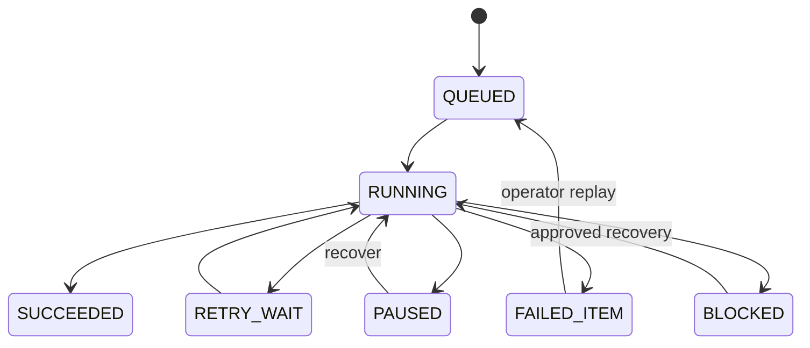

# Fail-safe, 개별 Item 재처리, 중단 로그 (v0.2 Draft)

## 1. 실패 경계
- **Item-local failure:** Item 필드 변환 실패, HTML Table 무결성 실패, 특정 Chunk 임베딩 실패, 첨부파일 개별 손상 등은 Item별 실패 레코드로 격리하고, 다른 Item은 처리한다. 신규 Revision의 활성 전환 금지/기존 판 유지.
- **Stage/global failure:** 인증 전체 만료, 서버 과부하 및 429 연속, SQLite Disk Full/Corruption, Qdrant 불가로 원자성 위험, 모델 digest 불일치, 범위 검증 실패, 비밀 누출 위험은 Job/Server를 PAUSED/BLOCKED로 전환한다. 무조건 '계속 진행'하지 않는다.
- **Partial success:** Job은 `SUCCEEDED`, `COMPLETED_WITH_ERRORS`, `PAUSED`, `BLOCKED`, `FAILED`, `CANCELLED` 등으로 구분한다. 성공 개수와 실패 개수는 일치 검사한다.

## 2. 단계 상태 모델

영속 테이블 후보: `Job`, `JobStep`, `JobItemAttempt`, `FailedItem`, `RateLimitState`, `Checkpoint`. FailedItem: `project_uid, item_uid, revision_uid, stage, error_class, retryable, attempt_count, last_error_code, trace_id, first_seen_at, last_seen_at, replay_after, resolution`.

## 3. Replay 계약
- API `GET /jobs/{job_id}/failed-items` 목록, `POST /jobs/{job_id}/failed-items/{item_uid}/retry` 단일 Item 단계 재실행, `POST /jobs/{job_id}/failed-items/retry` 조건에 맞는 실패 Item 일괄 재실행, `POST /jobs/{job_id}/resume` 영속 Job 재개. 모든 API는 프로젝트 관리 권한이 있어야 한다.
- Retry input: `from_stage=FAILED_STAGE|COLLECT|PROCESS|EMBED|INDEX`, `force_recollect=false`, `expected_revision_uid`; 단계 의존성을 검증해 잔여 처리만 수행한다.
- 멱등키: job_uid + item_uid + stage + revision_uid + config_fingerprint; 재시작/반복으로 중복 Revision/Vector 점이 생성되지 않아야 한다.
- 개별 Replay는 범위에서 제외되거나 삭제된 Item을 무작정 복구하지 않는다. 현재 Scope/권한 재확인 및 audit 기록 필수.
- 자동 제한 Retry와 사용자 요청 Replay는 서로 다른 retry budget을 가진다. Replay 중 새 Job이 이미 같은 프로젝트에서 동작 중이면 FIFO 큐에 들어가도록 한다.

## 4. 로그와 운영 지표
JSON 로그: `timestamp, severity, alm_instance_uid, project_uid, job_uid, item_uid, stage, step_uid, attempt, trace_id, http_status, error_code, retryable, action_taken, elapsed_ms`. Raw ALM body, 비밀번호, Authorization header, Query 원문은 기본 제외.

UI에서는 실패 위치와 원인 코드, Retry 가능 여부, 실패 비율, 영향받은 Item 수, Retry 시도 횟수와 최종 결과를 표시한다. Fail-safe는 **데이터 무결성 보호를 우선**한다.

## 5. Crash/E2E 시험
100 Item 중 3 Item local fail → 97 처리 + 3 FailedItem; 사용자 재실행 후 100 처리 및 중복 IndexPoint 0. Worker kill → checkpoint resume, staged Qdrant points 정리/유효화. DB 공간 부족/401 일괄 장애 → Job BLOCKED, 기존 활성 검색 정상.
